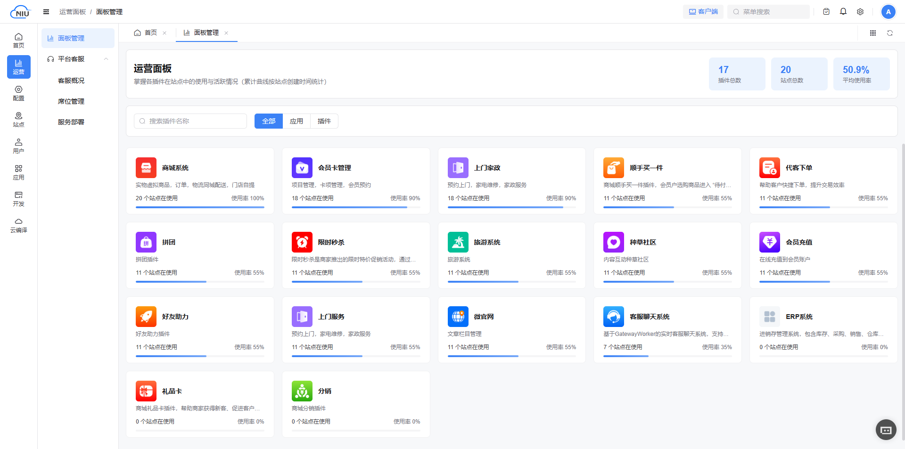
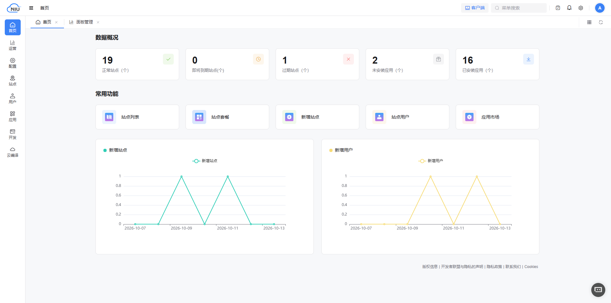
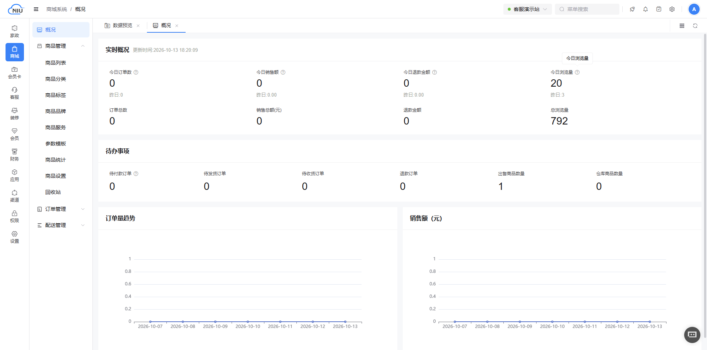
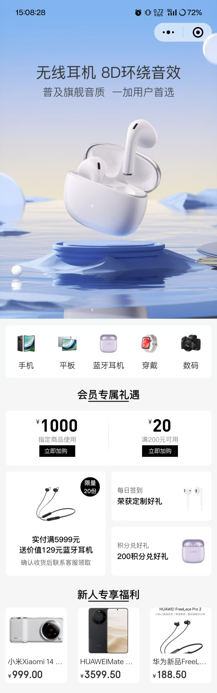
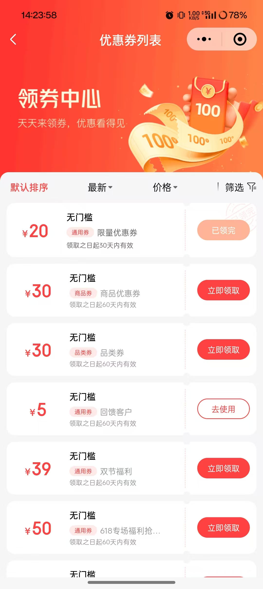
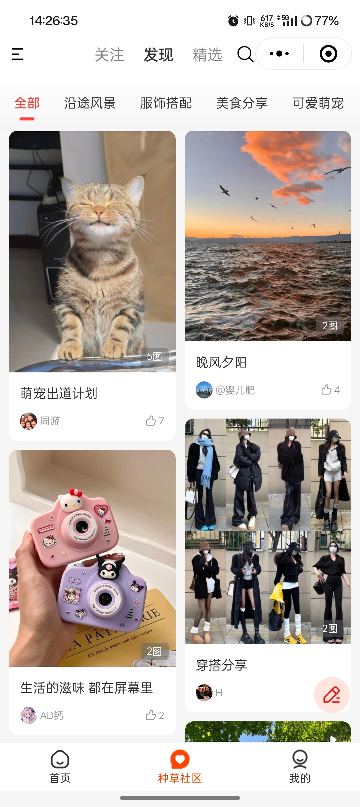
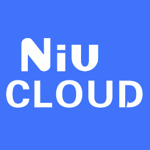

###  NIUCLOUD-ADMIN 是什么？

niucloud-admin-saas是一款快速开发通用管理后台框架，整体功能架构全部精心设计！代码干净整洁！低耦合，高质量！！！前后端API接口完全分离！！！前端采用最新技术**Vite+TypeScript+Vue3+ElementPlus**，后台采用PHP8、MYSQL8、THINKPHP8 全部最新技术栈，内置Workman高性能消息队列，计划任务处理，完全兼容容器路由运行技术。 采用多租户多站点多应用多插件任意组合使用的SAAS架构设计，内置代码生成器，插件生成器，一键云编译、一键云部署，集成用户权限、表单设计、云存储、短信发送、素材中心、微信及公众号、Api模块一系列开箱即用功能，是一款快速搭建开发企业级应用的软件系统。源码100%开源无加密！框架采用MIT协议，终身免费，商用免费！ 

目前NIUCLOUD生态开发者入驻近千人，各行业应用插件正在陆续上线中...

请到官方网站了解更多[https://www.niucloud.com](https://gitee.com/link?target=https%3A%2F%2Fwww.niucloud.com)

### NIUCLOUD-ADMIN 技术特点 

前端（**Vite+TypeScript+Vue3+ElementPlus**）+**API**接口完全分离 + 后端（**PHP8+THINKPHP8**\) + 数据库（**MYSQL8.0+**）

```
- 支持composer快速安装扩展，支持redis缓存以及消息队列，支持多语言设计开发，采用严格的restful的api设计开发。
- 后台前后端分离采用element-plus、vue3.0、typescript、vite、pina等前端技术,同时使用i18n支持国际化多语言开发。
- 手机端采用uniapp前后端分离，使用uview、vue3.0、typescript、vite、pina前端技术，支持h5,微信小程序，支付宝小程序，抖音小程序等使用场景。
- niucloud-admin采用多租户的saas系统设计，支持多站点多商户多门店多应用多插件组合使用。
- niucloud-admin前端以及后端采用严格的多语言开发规范，包括前端展示，api接口返回，数据验证，错误返回等全部使用多语言设计规范，使开发者能够真生意义上实现多语言的开发需求。
- niucloud-admin已经搭建好常规系统的开发底层，具体的底层功能包括：管理员管理，权限管理，网站设置，计划任务管理，素材管理，会员管理，会员账户管理，微信公众号以及小程序管理，
  支付管理，第三方登录管理，消息管理，短信管理，文章管理，前端装修等全面的基础功能，这样开发者不需要开发基础的结构而专心开发业务。
- niucloud-admin系统内置支持微信/支付宝支付，微信公众号/小程序/短信消息管理，阿里云/腾讯云短信，七牛云/阿里云存储等基础的功能扩展，后续会根据实际业务不断扩展基础组件。
- niucloud-admin结合系统结构特点专门开发了代码生成器，这样开发者根据数据表就可以一键生成基础的业务代码，包括：后台php业务代码以及对应的前端vue代码。
- 手机端设计开发了自定义装修，同时提供了基础的开发组件，方便开发者设计开发手机自定义页面装修的开发需求。

```
### 管理端framework





### 商城插件SHOP


<table>
    <tbody>
    <tr>
        <td></td>
        <td></td>
        <td></td>
        <td></td>
    </tr>
    <tr>
        <td></td>
        <td></td>
        <td></td>
        <td></td>
    </tr>	 
    </tbody>
</table>


### 操作指南

* [官网地址](https://www.niucloud.com)

* [服务市场](https://www.niucloud.com)
* [使用手册](https://www.niucloud.com/doc)
* [二开手册](https://www.niucloud.com/doc)
* [开发视频](https://www.niucloud.com/doc)
* [API接口手册](https://api.niucloud.com/apidoc.html?target_id=001)
* [论坛地址](https://niucloud.com/bbs)

### 演示地址

- 平台后台演示网址：[<a href='https://v2-cs.site.niucloud.com/admin' target="_blank"> 查看 </a>]
  <a href='https://v2-cs.site.niucloud.com/admin' target="_blank">https://v2-cs.site.niucloud.com/admin</a><br>
  账号：admin 密码：123456


### 加入NIUCLOUD开发者生态，一起助力成就程序员创业梦想！！！

加入企业微信群技术交流，请扫描下面二维码:


### 产品LOGO




### 开源使用须知

1.允许用于个人学习、毕业设计、教学案例、公益事业、商业使用;

2.本框架应用源代码所有权和著作权归niucloud官方所有，基于niucloud-admin框架开发的应用，所有权和著作权归应用开发商所有。但必须明确声明是基于niucloud-admin框架开发，请自觉遵守，否则产生的一切任何后果责任由侵权者自负;

3.禁止修改框架代码并再次发布框架衍生版等与niucloud-admin框架产生恶意竞争或对抗的行为;

4.本框架源码全部开源;包括前端，后端，无任何加密;

5.商用请仔细审查代码和漏洞，不得用于任一国家许可范围之外的商业应用，产生的一切任何后果责任自负;

6.一切事物有个人喜好的标准，本开源代码意在分享，不喜勿喷。

### 版权信息
版权所有Copyright © 2015-2026 niucloud-admin 版权所有


杭州数字云动科技有限公司
杭州牛之云科技有限公司
提供技术支持
